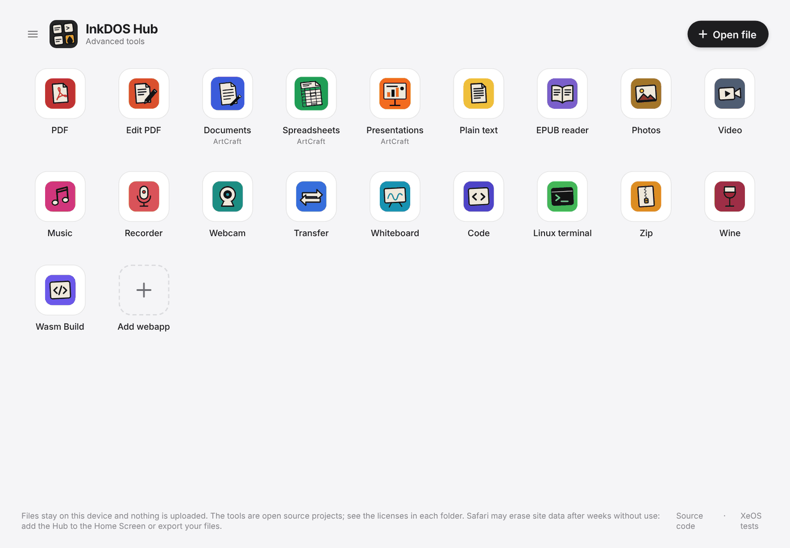
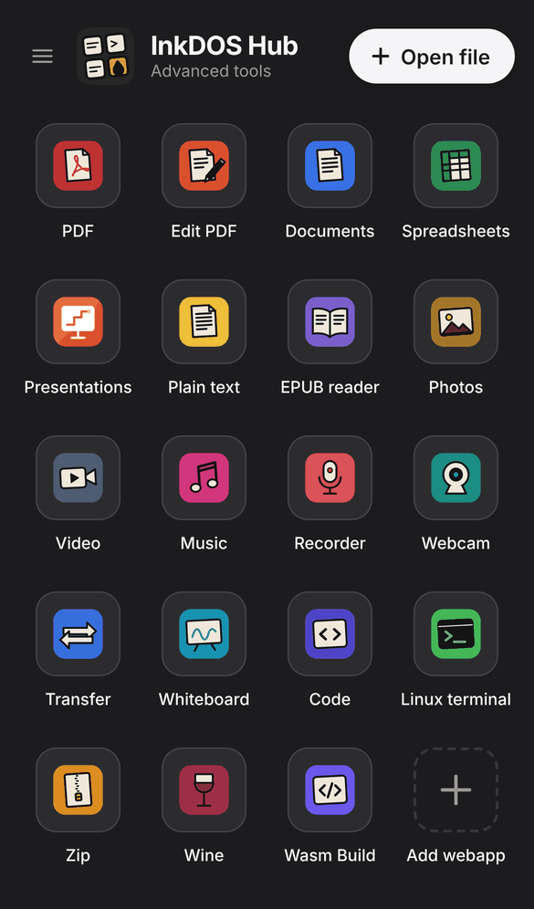

# InkDOS Hub

A free, open-source home screen of power tools for iPad and iPhone (Safari and XeOS), also available as a Windows app. Everything runs in the browser: a real Alpine Linux terminal, photo, video and music apps, VS Code for the web, a whiteboard, document, spreadsheet, presentation and PDF apps, a recorder, phone-to-PC file transfer and an iPhone-as-PC-webcam app. No account, no tracking: your files stay on your device. Everything lives in this repository; nothing is loaded from CDNs or other sites.

**Open:** https://inkdoshub.github.io/ · License: MIT (third-party licenses in [LICENCAS.md](LICENCAS.md))

Docs: [Contributing](CONTRIBUTING.md) · [Security](SECURITY.md) · [Support](SUPPORT.md) · [Code of Conduct](CODE_OF_CONDUCT.md) · [Code audit logs](auditoria/README.md)

<p> </p>

> **No support promised.** InkDOS Hub is a personal project made in spare time. It was tested on iPhone, iPad and a Windows laptop; other devices may or may not work. Feel free to use, copy and adapt it, but fixes, new features and quick answers are not guaranteed. 🙂

## Apps

| App | Tool (open source) | Folder |
|---|---|---|
| PDF, Documents, Spreadsheets, Presentations, Plain text, EPUB reader | InkDOS apps (2.9.0), copied here and maintained in this repo: New, Open and Save in the ☰ menu; in Documents, Spreadsheets and Presentations the editing ribbon sits behind the brush button | `inkdos/` |
| WordCraft, GridCraft, DeckCraft | [ArtCraft](https://github.com/storytold) editors (MIT/Apache-2.0) for text, spreadsheets and presentations, downloaded from their web releases by the `artcraft.yml` action | `artcraft/` and `apps/*craft/` |
| Edit PDF | [BentoPDF](https://github.com/alam00000/bentopdf) (AGPL-3.0): merge, split, compress, convert, sign, protect, OCR and more, each tool with the Hub top bar | `apps/editar-pdf/` (list) and `visualizadores/bentopdf/` |
| Viewers (inside the document apps) | OpenDocument (.odt/.ods/.odp, WebODF) and Apple (.pages/.numbers/.key, pnk), view only | `visualizadores/` |
| Photos | Gallery, viewer and simple editor (crop, rotate, flip, straighten, exposure, brightness, contrast, saturation, warmth, tint) | `apps/foto/` |
| Video | Player and simple editor (trim, sound, export at original/1080p/720p/480p) with single-thread ffmpeg.wasm 0.12.5 | `apps/video/` |
| Music | Player with playlist, 10-band equalizer, volume boost, balance and speed | `apps/musica/` |
| Recorder | Records computer audio, microphone or screen sound; each recording downloads automatically and shows up in Music | `apps/gravador/` |
| Webcam | Turns the iPhone camera into a PC webcam over WebRTC (up to 4K 60 fps), paired by QR code with [PeerJS](https://github.com/peers/peerjs) (its free public server is used only for pairing). On Windows, OBS Studio or the native receiver turns it into a virtual camera | `apps/webcam/` |
| Transfer | Sends files between the phone and a Windows PC over the local network (WebRTC), no internet needed, with connection diagnostics | `apps/transferir/` |
| Whiteboard | [Excalidraw](https://github.com/excalidraw/excalidraw) (MIT), saved in IndexedDB | `apps/quadro/` |
| Code | [VS Code for the web](https://github.com/Felx-B/vscode-web) (MIT), with a folder stored in the browser | `apps/codigo/` |
| Linux terminal | Alpine Linux 3.22 on [v86](https://github.com/copy/v86) | `terminal/` |

The home screen is an app drawer (icon and name, like Launchpad) with search, a folder button that opens any file in the right app, and the ☰ menu with theme, language, Offline mode, Customize (hide apps, drag to reorder) and the default Office app (InkDOS, fast, or ArtCraft, full). Each tool opens only when asked and manages its own memory. All pages share the same top bar and light/dark theme (`assets/barra.css`, `assets/tema.js`).

Every third-party folder has `UPSTREAM-LICENSE.txt` and `UPSTREAM-SOURCE.txt`; `tools/build_apps.sh` rebuilds the tools from their pinned versions.

## How it works

1. **Home screen** (`index.html`, `inicio/`): lists the apps, opens files in the right app and keeps preferences in the site's `localStorage` (`inkdoshub-*` keys).
2. **Passing files between apps:** the home screen stores the chosen file in the `inkdos-tool-handoff` IndexedDB and opens the app with `?inkdos-handoff=<id>`; the app reads the record and deletes it. Nothing leaves the device.
3. **Manifest** (`inicio/manifesto.json`, generated by `tools/portal_manifesto.py`): lists every file of the site by group (app), with size and full SHA-256. It drives Offline mode, partial updates and the Windows integrity check.
4. **Service worker** (`sw-portal.js`): only active when an offline copy exists; serves from the cache and only replaces a file when its hash in the manifest changes.
5. **Third-party apps** (BentoPDF, ArtCraft, VS Code, Excalidraw, v86, ffmpeg.wasm) are copied here with pinned versions and their licenses.
6. **Integrity and isolation:** the offline copy and the Windows app check every file against the manifest SHA-256 before using it, and every page has a Content Security Policy (scripts only from this site, network only to the servers that page needs). Details in [auditoria/021](auditoria/021-integrity.md) and [022](auditoria/022-app-isolation.md).

**Offline mode:** in the ☰ menu, each app can be stored on the device (a green check per app; the base always comes along; everything together is about 700 MB) and then opens from there, even without internet. When the site changes, the home screen shows "Update available · Update", and one tap downloads only what changed (`inicio/offline.js`, `sw-portal.js`).

## Versions

| Version | How to use | Specifics |
|---|---|---|
| **Web** | Open https://inkdoshub.github.io/ in Safari, Chrome, Edge or Firefox | Always the latest version. Files live in the browser storage (IndexedDB/OPFS); clearing site data erases them. Safari may clear data of rarely used sites; Offline mode and the Home Screen install prevent that. |
| **Home Screen (iPhone/iPad)** | Safari › Share › Add to Home Screen | Opens full screen like an app (`manifest.webmanifest`) with a service worker, so Offline mode works and the copy updates through the "Update" notice. |
| **XeOS (container in the iOS Dock)** | Add the Hub as a Web App in XeOS | XeOS uses WKWebView without service workers, so Offline mode is hidden and the site always loads from the internet. It blocks `confirm()`/`alert()` and downloads inside iframes, so the Hub acts without pop-ups and redirects downloads to the main page. Opening a file from XeOS always goes through the home screen, which hands it to the right app. No screen sharing, so the Recorder only records the microphone. |
| **Windows (installed)** | `InkDOSHub-Setup.exe` or the portable `.zip` from the [hub-windows release](https://github.com/InkDOSHub/inkdoshub.github.io/releases/tag/hub-windows) | Lean Electron app (`windows/hub/`) with **the same apps as the web**, no substitutes. Stored apps live in `%LOCALAPPDATA%\InkDOS Hub\site`, and every file is checked against the manifest SHA-256 before it is served; the rest comes from the site, also checked. Network is allowed only to the site and PeerJS pairing; no telemetry. The Recorder captures the screen and PC sound (or a single program). The `.exe` is not code-signed yet, so SmartScreen may warn ([ASSINATURA.md](ASSINATURA.md)). |
| **Windows helpers** | Webcam and Transfer, in [windows/](windows/) | Small optional programs: native Webcam receiver (GStreamer) and local-network Transfer. Also unsigned. |

## Languages

The site ships in English only. Other languages (Portuguese, Spanish, German, French, Simplified Chinese, Japanese and Russian) are optional packs: the language button on the home screen opens a notice that says what the pack translates, what stays in English and how many MB it adds. One pack at a time is kept on the device; picking another removes the previous one.

- Each pack has the home screen and app texts (`idiomas/<code>.json`) plus the Whiteboard and InkDOS app languages. The file list and sizes are generated by `tools/portal_manifesto.py` (`idiomas` key of `inicio/manifesto.json`); the offline copy keeps only English.
- Code (VS Code) and Linux stay in English; only their top bar is translated.
- How it works: `assets/idioma.js`. New interface text is written in English (in HTML inside `<body data-idioma>`, or in JavaScript with `InkIdioma.t("...")`); `python3 tools/idiomas_textos.py` lists the texts and what is missing in each pack.

## Linux terminal

- Runs Alpine Linux 3.22 with Linux kernel 6.6 (i386), emulated by [v86](https://github.com/copy/v86) in WebAssembly.
- Installs any Alpine package with `apk add` (for example `apk add python3 git nano`).
- Real internet inside Linux, with http and https (see "Network" below).
- **Session:** saves the list of installed packages and the home folder in a password-protected file; on another device (or after clearing data) it reinstalls the packages and restores the files. Details in `inicio/README.md`.
- The `~/files` folder exchanges files with the device: **Upload** puts files in it, **Download** saves files from it.
- **Save** stores the whole machine (files, installed programs and `~/files`) in the browser, and the next visit resumes from there. **Restart** erases everything and boots fresh.
- **Memory:** the button switches between 256 MB (default, session can be saved) and **640 MB + swap**: 640 MB RAM, 192 MB zram and 1 GB swap in a file in the site's private storage (OPFS), written in chunks by a worker (`terminal/swap-worker.js`) without going through page RAM. The tab stays under 1 GB. In this mode the session is not saved, because swap restarts on each boot.
- Extra key bar for the phone keyboard: Esc, Tab, Ctrl, arrows, `|`, `/`, `-`, `~` and Ctrl+C.

### Network

Like other in-browser Linux emulators (such as [copy.sh/v86](https://copy.sh/v86/)), Linux reaches the internet through a public network server, so `apk add`, `http://`, `https://`, `git clone`, `pip install` and `ssh` work.

| Option | How it works |
|---|---|
| Network: wisp (default) | TCP connections through the public [Wisp](https://github.com/MercuryWorkshop/wisp-protocol) server `wisps://wisp.mercurywork.shop/v86/` (the same one copy.sh/v86 offers). Names are resolved by Cloudflare DNS-over-HTTPS. |
| Network: relay | Full network through the public v86 relay (`wss://relay.widgetry.org/`). Use it if wisp is down. |
| No network | Linux stays offline. |

These are free third-party servers and may be slow or down. The choice is stored in the browser. You can also pass `?rede=wisp`, `?rede=relay`, `?rede=off` or a `wss://`, `wisp://` or `wisps://` URL of another server.

### URL parameters (terminal/)

| Parameter | Effect |
|---|---|
| `?embed=1` | Hides the top bar (for use inside an iframe) |
| `?fresh=1` | Ignores saved state and boots fresh |
| `?font=18` | Changes the font size |
| `?rede=…` | Picks the network (see above) |
| `?memoria=limitada` | Turns on 640 MB + swap mode (`?memoria=normal` goes back to 256 MB) |

### Embedding

```html
<iframe src="https://inkdoshub.github.io/terminal/?embed=1" style="width:100%;height:100%;border:0"></iframe>
```

### Limitations

- It is emulation, so it is much slower than a real computer. Installing Python takes a few minutes.
- The system lives in memory (256 MB). Installed programs only persist after tapping **Save**.
- Saved state weighs 20 to 100 MB, depending on what is installed.

### Structure

| Path | What it is |
|---|---|
| `terminal/index.html`, `app.js`, `style.css` | The terminal page |
| `terminal/vendor/v86/` | v86 emulator 0.5.471 (BSD-2) |
| `terminal/vendor/xterm/` | xterm.js 6.0.0 + addon-fit (MIT) |
| `terminal/bios/` | SeaBIOS and VGA BIOS (LGPL-3) |
| `terminal/images/inkdoshub-bzImage.bin` | Linux 6.6 kernel with embedded Alpine (GPL-2 and Alpine licenses) |
| `tools/linux/` | Script and configs to rebuild the image |

### Rebuilding the Linux image

Needs a Linux machine (or CI runner) with `gcc make flex bison bc cpio libelf-dev git`:

```sh
./tools/linux/build.sh
```

The kernel comes from `torvalds/linux` at tag `v6.6`, unmodified. Alpine comes from the official x86 minirootfs (`alpinelinux/docker-alpine`, branch `v3.22`), with its checksum verified. InkDOS Hub's own files are in `tools/linux/alpine-overlay/`.

## Code signing

The Windows programs are not code-signed yet (SignPath Foundation declined the request on 2026-10-29; it can be requested again later). Until then, check the SHA-256 published in the release. Policy: [ASSINATURA.md](ASSINATURA.md).
