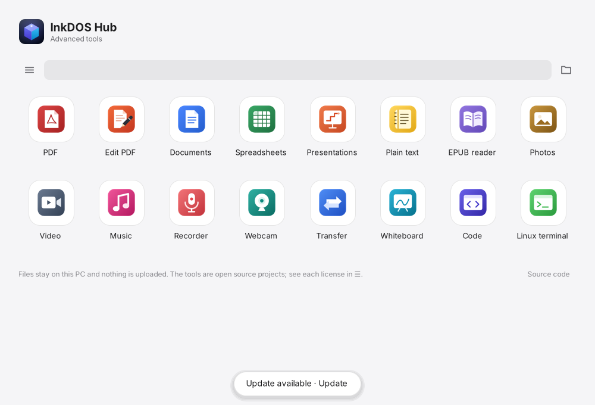
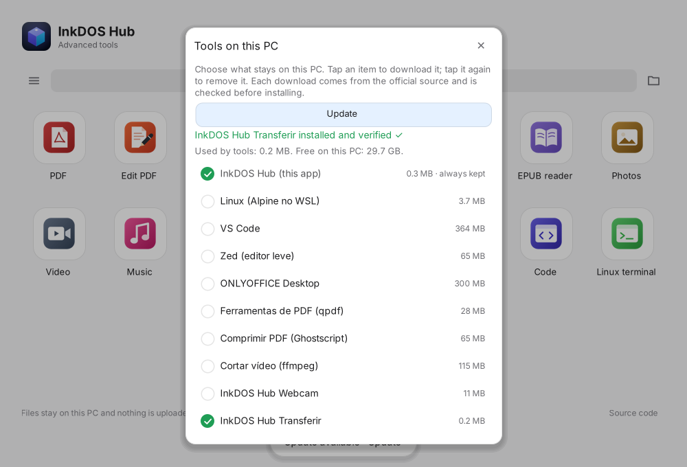

# 016 · Windows com o visual do Hub (2026-10-30)

Pedido: a versão 0.1 do app de Windows ficou com cara de programa antigo. Ela devia ter a mesma formatação do Hub,
o mesmo esquema de baixar ou não cada recurso, com o check verde, e rodar melhor que o site no navegador.

## O que mudou (versão 0.2)

- **Tela inicial** (`windows/hub/Inicio.cs`): é a mesma gaveta de apps do site, desenhada num controle só, sem motor web.
  - Tem a marca, a barra com ☰, a busca e a pasta, os 16 apps na mesma ordem e com os mesmos ícones, e o rodapé.
  - Usa as cores e medidas de `assets/home.css`, nos temas claro e escuro.
  - Os ícones vêm de `assets/icones-inkdos/`, convertidos para PNG em `windows/hub/icones/`.
  - O app que já está no PC ganha um check verde.
  - Os apps sem versão nativa (PDF, EPUB, Fotos, Música, Gravador, Quadro) abrem o site no navegador. Texto simples abre o Bloco de Notas.
- **☰** (`MenuPop`): mesmo cartão do site. Tem o tema claro ou escuro, "Ferramentas neste PC", o editor de código (VS Code ou Zed), segurança e privacidade, e abrir no navegador.
- **Ferramentas neste PC**: é o Modo Offline do site, com um check verde por ferramenta.
  - Tocar num item abre, embaixo dele, de onde vem, quem publica, a licença, a versão, o tamanho, o espaço livre e a segurança, com o botão "Baixar e instalar".
  - Enquanto baixa, o check gira, a linha enche com o progresso e o status diz a etapa e a porcentagem. Os outros itens ficam apagados.
  - Tocar num item marcado pede, na própria janela, a confirmação para remover.
  - "Atualizar" baixa só as ferramentas com versão nova e, depois, o próprio Hub.
- **Painéis** (`Camada`): ficam sobre uma foto escurecida da tela inicial e não usam caixas de diálogo.
- Arquivo `config.txt` no formato chave=valor (tema, editor). Ainda lê o formato da 0.1.

## Desempenho

- Continua um .exe pequeno, de .NET Framework 4.8, que já vem no Windows. Não tem motor web.
- A tela é pintada uma vez e os ícones são reduzidos uma vez e guardados.
- Com as janelas paradas, não há trabalho. O único timer gira o check só durante um download.
- Ainda falta medir no PC real.

## Como foi conferido

- Compilado com o dotnet 8 (`-p:EnableWindowsTargeting=true`), sem avisos.
- Rodado no Linux com Mono e Xvfb, clicando com o xdotool. Foram conferidos:
  - a tela inicial, o ☰, o painel e os detalhes;
  - um download de verdade (Transferir, 0,2 MB), com o SHA-256 conferido e o check verde depois;
  - o tema escuro.
- No Mono a busca não mostra o texto "Buscar", porque o SendMessage não existe lá. No Windows ele funciona.

