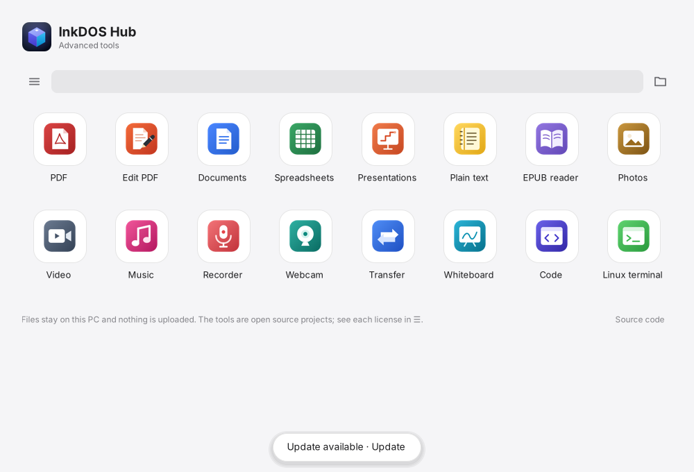
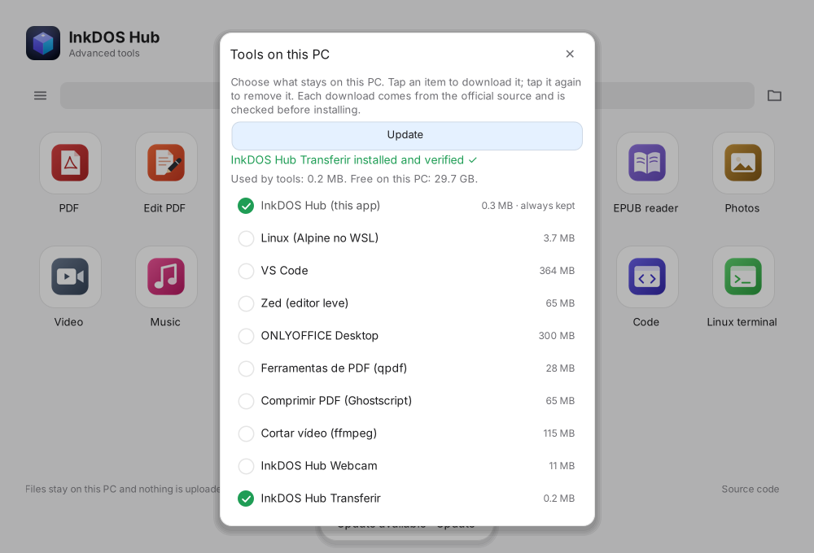

# 016 · Windows with the Hub look (2026-10-30)

> Superseded by log 018 (Electron, the same apps as the web). Kept as history.

Request: version 0.1 of the Windows app looked like an old program. It should have the same layout as the Hub,
the same download-or-not scheme for each feature, with the green check, and run better than the site in the browser.

## What changed (version 0.2)

- **Home screen** (`windows/hub/Inicio.cs`): the same app drawer as the site, drawn in a single control, no web engine.
  - It has the brand, the bar with ☰, search and folder, the 16 apps in the same order with the same icons, and the footer.
  - Uses the colors and sizes from `assets/home.css`, in light and dark themes.
  - Icons come from `assets/icones-inkdos/`, converted to PNG in `windows/hub/icones/`.
  - An app already on the PC gets a green check.
  - Apps without a native version (PDF, EPUB, Photos, Music, Recorder, Whiteboard) open the site in the browser. Plain text opens Notepad.
- **☰** (`MenuPop`): the same card as the site. Light or dark theme, "Tools on this PC", the code editor (VS Code or Zed), security and privacy, and open in browser.
- **Tools on this PC**: the site's Offline mode, with a green check per tool.
  - Tapping an item opens, below it, where it comes from, publisher, license, version, size, free space and security, with a "Download and install" button.
  - While downloading, the check spins, the row fills with progress and the status says the step and percentage. Other items are dimmed.
  - Tapping a checked item asks, in the window, for confirmation to remove.
  - "Update" downloads only the tools with a new version and then the Hub itself.
- **Panels** (`Camada`): sit over a darkened snapshot of the home screen and use no dialog boxes.
- `config.txt` file in key=value format (theme, editor). Still reads the 0.1 format.

## Performance

- Still a small .exe on .NET Framework 4.8, built into Windows. No web engine.
- The screen is painted once and icons are scaled once and cached.
- With windows idle, there is no work. The only timer spins the check during a download.
- Still needs measuring on the real PC.

## How it was checked

- Built with dotnet 8 (`-p:EnableWindowsTargeting=true`), no warnings.
- Run on Linux with Mono and Xvfb, clicking with xdotool. Checked:
  - the home screen, ☰, the panel and the details;
  - a real download (Transfer, 0.2 MB), with SHA-256 verified and the green check afterwards;
  - the dark theme.
- On Mono the search box does not show the "Search" placeholder, because SendMessage does not exist there. It works on Windows.

