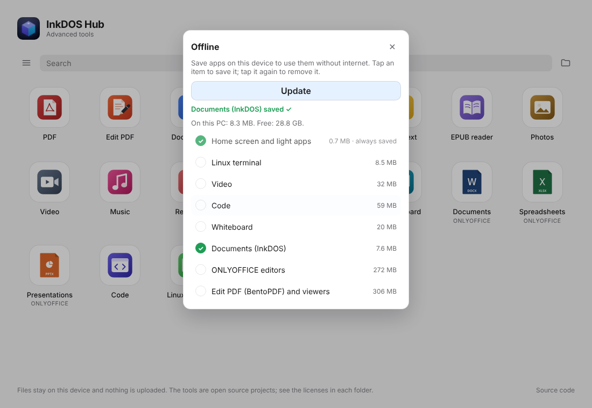

# 018 — InkDOS Hub for Windows on Electron (2026-10-30)

## Why
Logs 016 and 017 replaced Hub apps with third-party programs (SumatraPDF, Windows apps). The request was different: the apps must be **the same as the web version**, without a browser. Tests on Paulo's PC (i5-1235U, 8 GB), with `windows/teste-desempenho.bat` and `windows/teste-arquivos.bat` (files from the `arquivos-teste` release):

| Engine | Home screen (MB) | + 7 apps (MB) | Open complex file (s, average) | Complex file memory (MB) |
|---|---|---|---|---|
| Edge | 272 | 953 | 0.78 | 280 |
| Brave | 235 | 910 | 0.81 | 258 |
| WebView2 | 172 | 799 | 0.80 | 236 |
| Electron | — | — | 0.7 (without video*) | 260 |

\* In Electron the video autoplayed and the screen never "stopped changing" until the end; it is not slowness.

Electron and WebView2 tie, and Electron does not depend on Edge. Chosen: **official Electron, trimmed**.

The tests also found a Text app problem: a 20 MB .txt cost ~650 MB in any engine. Fixed in `inkdos/apps/txt/runtime/platform/texto-grande.js`, which keeps only a window of the document in the field; it now costs +96 MB.

## Result (`windows/hub/`)
- `main.js`:
  - Opens `https://inkdoshub.github.io/` in its own window, and each app opens in its own window.
  - Every request to the site goes through the app. What is stored opens from disk (`%LOCALAPPDATA%\InkDOS Hub\site`). The rest comes from the site and is checked by SHA-256.
- `preload.js`:
  - `window.inkHubNativo` connects the home screen "Offline" to the disk. Same panel with the green check; `inicio/offline.js` only changes the destination.
  - Shows the notice in the Code app to use native VS Code.
- `inicio/manifesto.json` now carries the full SHA-256 of each file (4th field).
- **Webcam:** the icon downloads the native Webcam app (webcam-windows release, verified by SHA-256) and opens it, instead of the iPhone page.
- **Terminal:**
  - With WSL installed, the icon opens Windows' own Linux in Windows Terminal (`wt.exe wsl.exe`).
  - Without WSL, it explains and installs with `wsl --install -d Ubuntu` (asks for administrator once). The site terminal (v86) remains an option.
- **Code:**
  - With VS Code installed, the icon opens native VS Code, with telemetry turned off in settings.json if the person has not chosen yet.
  - Without VS Code, it offers to install the official one: the installer comes from Microsoft, per-user, no administrator, and the SHA-256 from their update API is verified. The site Code app remains an option.
- **Icons:** each file type has the icon of the app that opens it (`windows/hub/tipos/*.ico`).
- **Opening files:**
  - The installer registers the Hub in "Open with" and Default apps for PDF, Office, TXT, EPUB, photos, video and music (HKCU, no administrator).
  - When a file is opened, the right app opens with it loaded, through the app's own "Open" field (DevTools Protocol, local).
- **Updatable shell:**
  - The action numbers each build (0.3.N) and publishes `versao.json` with the installer SHA-256.
  - The app checks 20 s after opening and every 6 h. If there is a new version, it downloads the installer and verifies the SHA-256.
  - It then shows "New app version · Restart" and installs silently (Inno `/VERYSILENT`, no administrator). If the person does not tap, it installs on close.
- **App updates:** uses the same home screen "Update available" and downloads only what changed. The installer ships only the shell. The action runs weekly to pick up new Electron releases.
- **Privacy:**
  - Chromium background services are off.
  - The network only reaches the site and `0.peerjs.com` (Transfer/Webcam); everything else is blocked.
  - No spell checker, which would download dictionaries from Google.
  - Camera and microphone are only allowed for the site, and location is never allowed.
- **Trimmed (`montar.ps1`):**
  - Official Electron verified by their SHA-256.
  - Only the Chromium en-US locale (the Hub's 7 languages come from the site).
  - No sample app and no SwiftShader/Vulkan.
- **Installer (`instalador.iss`):** Inno Setup, no administrator. A portable .zip is also produced.
- The WinForms launcher (0.1/0.2), the native tools catalog and SumatraPDF were removed.

## Tested (Linux, Electron 45.2)
- The home screen opens and stores the base by itself. "Documents (InkDOS)" was stored in 0.6 s, with the green check and the PC space.
- An app opens in a new window.
- Without internet, the home screen and PDF opened from disk. An app that is not stored shows how to store it.
- `fetch` to Google was blocked, and the page has no `require` (Node isolated).

## Pending
- Test on the Windows PC: installer, memory with several apps.
- Code signing of the .exe (SignPath declined on 2026-10-29).
