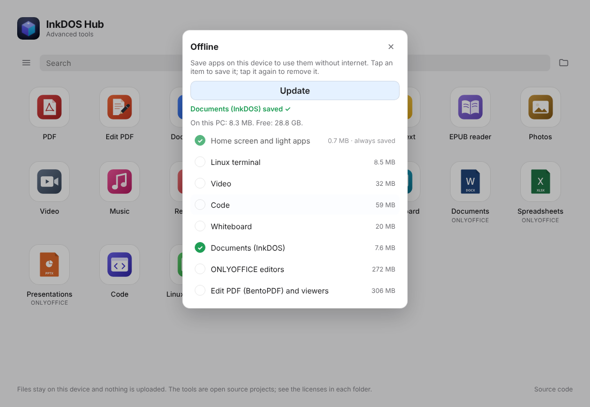

# 018 — InkDOS Hub para Windows em Electron (2026-10-30)

## Por quê
Os logs 016 e 017 trocaram apps do Hub por programas de terceiros (SumatraPDF, apps do Windows). O pedido era outro: os apps têm de ser **os mesmos da versão web**, sem navegador. Testes no PC do Paulo (i5-1235U, 8 GB), com `windows/teste-desempenho.bat` e `windows/teste-arquivos.bat` (arquivos da release `arquivos-teste`):

| Motor | Tela inicial (MB) | + 7 apps (MB) | Abrir arquivo complexo (s, média) | Memória do arquivo complexo (MB) |
|---|---|---|---|---|
| Edge | 272 | 953 | 0,78 | 280 |
| Brave | 235 | 910 | 0,81 | 258 |
| WebView2 | 172 | 799 | 0,80 | 236 |
| Electron | — | — | 0,7 (sem o vídeo*) | 260 |

\* No Electron o vídeo tocou sozinho e a tela não "parou de mudar" até o fim; não é lentidão.

Electron e WebView2 empatam, e o Electron não depende do Edge. Escolhido: **Electron oficial, enxuto**.

Os testes também acharam um problema do app Texto: um .txt de 20 MB custava ~650 MB em qualquer motor. Corrigido em `inkdos/apps/txt/runtime/platform/texto-grande.js`, que deixa o campo com só uma janela do documento, e agora custa +96 MB.

## Como ficou (`windows/hub/`)
- `main.js`:
  - Abre `https://inkdoshub.github.io/` numa janela própria, e cada app abre na sua janela.
  - Todos os pedidos ao site passam pelo app. O que está guardado abre do disco (`%LOCALAPPDATA%\InkDOS Hub\site`). O resto vem do site e é conferido pelo SHA-256.
- `preload.js`:
  - `window.inkHubNativo` liga o "Offline" da tela inicial ao disco. É o mesmo painel com check verde, e `inicio/offline.js` só troca o destino.
  - Mostra o aviso no app Código para usar o VS Code nativo.
- `inicio/manifesto.json` agora leva o SHA-256 inteiro de cada arquivo (4º campo).
- **Webcam:** o ícone baixa o app nativo da Webcam (release webcam-windows, conferido pelo SHA-256) e abre esse app, em vez da página do iPhone.
- **Terminal:**
  - Com o WSL instalado, o ícone abre o Linux do próprio Windows no Terminal do Windows (`wt.exe wsl.exe`).
  - Sem o WSL, explica e instala com `wsl --install -d Ubuntu` (pede administrador uma vez). O terminal do site (v86) fica de opção.
- **Abrir arquivos:**
  - O instalador registra o Hub no "Abrir com" e em Aplicativos padrão para PDF, Office, TXT, EPUB, fotos, vídeo e música (HKCU, sem administrador).
  - Ao abrir um arquivo, o app certo abre com ele carregado, pelo campo "Abrir" do próprio app (DevTools Protocol, local).
- **Carcaça atualizável:**
  - A action numera cada build (0.3.N) e publica `versao.json` com o SHA-256 do instalador.
  - O app confere 20 s depois de abrir e a cada 6 h. Se houver versão nova, baixa o instalador e confere o SHA-256.
  - Então mostra "Nova versão do app · Reiniciar" e instala em silêncio (Inno `/VERYSILENT`, sem administrador). Se a pessoa não tocar, instala ao fechar.
- **Atualização dos apps:** usa o mesmo "Atualização disponível" da tela inicial e baixa só o que mudou. O instalador traz só a carcaça. A action roda toda semana para pegar o Electron novo.
- **Privacidade:**
  - Os serviços de fundo do Chromium estão desligados.
  - A rede só alcança o site e o `0.peerjs.com` (Transferir/Webcam), e todo o resto é bloqueado.
  - Não há corretor ortográfico, que baixaria dicionários do Google.
  - Câmera e microfone só valem para o site, e a localização nunca é liberada.
- **Enxuto (`montar.ps1`):**
  - Electron oficial conferido pelo SHA-256 deles.
  - Só o idioma en-US do Chromium (os 7 idiomas do Hub vêm do site).
  - Sem o app de exemplo e sem SwiftShader/Vulkan.
- **Instalador (`instalador.iss`):** Inno Setup, sem administrador. Também sai uma versão portátil em .zip.
- O lançador WinForms (0.1/0.2), o catálogo de ferramentas nativas e o SumatraPDF saíram.

## Testado (Linux, Electron 45.2)
- A tela inicial abre e guarda sozinha a base. "Documents (InkDOS)" foi guardado em 0,6 s, com check verde e o espaço do PC.
- Um app abre em janela nova.
- Sem internet, a tela inicial e o PDF abriram do disco. Um app não guardado mostra como guardá-lo.
- `fetch` para o Google foi bloqueado, e a página não tem `require` (Node isolado).

## Falta
- Testar no PC com Windows: instalador, memória com vários apps.
- Assinatura do .exe (SignPath recusou em 2026-10-29).
